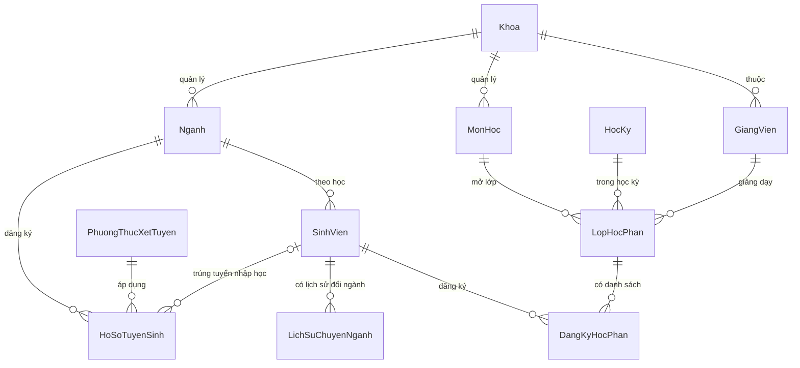
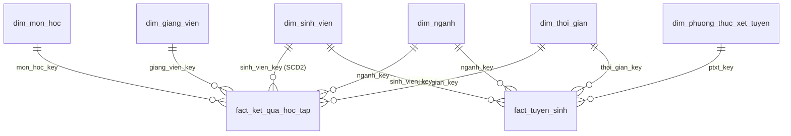

# Tài liệu Thiết kế CSDL Nguồn (3NF), Star Schema và Bảng Mapping Nguồn → Kho

Tài liệu này dùng chung cho cả 3 thành viên:
- **Cao Huy Hoàng**: đối chiếu cấu trúc bảng và quy tắc ETL/SCD2.
- **Võ Nguyễn Thành Long**: dùng sơ đồ và bảng từ điển dữ liệu dưới đây để vẽ trên **draw.io / MySQL Workbench** và đưa vào chương Thiết kế của báo cáo.
- **Nguyễn Thanh Tùng**: tra cứu tên cột trong Kho dữ liệu (`edu_dw`) khi viết truy vấn OLAP và dựng Dashboard Power BI.

---

## 1. Sơ đồ ERD hệ thống nguồn `edu_source` (Chuẩn hóa 3NF)

---

## 2. Sơ đồ Kho dữ liệu `edu_dw` (Star Schema với Conformed Dimensions)

Hai bảng Fact (`fact_ket_qua_hoc_tap`, `fact_tuyen_sinh`) dùng chung 3 chiều chuẩn hóa (**Conformed Dimensions**): `dim_sinh_vien`, `dim_nganh`, `dim_thoi_gian`.

---

## 3. Bảng Mapping Nguồn (`edu_source`) → Kho (`edu_dw`)

### 3.1. Các bảng Dimension

| Bảng đích (`edu_dw`) | Cột đích | Kiểu dữ liệu | Nguồn (`edu_source`) | Quy tắc biến đổi (Transform) |
|---|---|---|---|---|
| `dim_thoi_gian` | `thoi_gian_key` | `INT (PK)` | Sinh từ lịch + `HocKy` | Định dạng `YYYYMMDD` (ví dụ `20220905`) |
| `dim_thoi_gian` | `ngay`, `thang`, `quy`, `nam` | `DATE`, `TINYINT`, `SMALLINT` | Chuỗi ngày 2019–2027 | Tách ngày, tháng, quý (1–4), năm |
| `dim_thoi_gian` | `hoc_ky`, `hoc_ky_so`, `nam_hoc` | `VARCHAR`, `TINYINT` | `HocKy` | Tháng 8–1 thuộc HK1, tháng 2–7 thuộc HK2 |
| `dim_nganh` | `nganh_key` | `INT AUTO_INCREMENT (PK)` | Surrogate key | Khóa thay thế tự tăng |
| `dim_nganh` | `ma_nganh`, `ten_nganh`, `he_dao_tao` | `VARCHAR` | `Nganh` | Trim, chuẩn hóa chữ hoa/thường cho `ten_nganh` bị lỗi |
| `dim_nganh` | `ma_khoa`, `ten_khoa` | `VARCHAR` | `Nganh` ⋈ `Khoa` | Phi chuẩn hóa (denormalize) tên khoa vào chiều ngành |
| `dim_mon_hoc` | `mon_hoc_key` | `INT AUTO_INCREMENT (PK)` | Surrogate key | Khóa thay thế tự tăng |
| `dim_mon_hoc` | `ma_mon`, `ten_mon`, `so_tin_chi`, `loai_mon`, `ma_khoa`, `ten_khoa` | `VARCHAR`, `TINYINT` | `MonHoc` ⋈ `Khoa` | Phi chuẩn hóa tên khoa quản lý môn học |
| `dim_giang_vien` | `giang_vien_key` | `INT AUTO_INCREMENT (PK)` | Surrogate key | Khóa thay thế tự tăng |
| `dim_giang_vien` | `ma_gv`, `ho_ten`, `hoc_vi`, `ma_khoa`, `ten_khoa` | `VARCHAR` | `GiangVien` ⋈ `Khoa` | Chuẩn hóa Title Case `ho_ten`, gộp thông tin khoa |
| `dim_phuong_thuc_xet_tuyen` | `ptxt_key` | `INT AUTO_INCREMENT (PK)` | Surrogate key | Khóa thay thế tự tăng |
| `dim_phuong_thuc_xet_tuyen` | `ma_ptxt`, `ten_phuong_thuc`, `thang_diem`, `mo_ta` | `VARCHAR`, `DECIMAL(6,1)` | `PhuongThucXetTuyen` | Giữ nguyên thang điểm gốc (30.0 hoặc 1200.0) |
| `dim_sinh_vien` **(SCD2)** | `sinh_vien_key` | `INT AUTO_INCREMENT (PK)` | Surrogate key | Khóa thay thế cho từng phiên bản lịch sử (`-1` = Unknown) |
| `dim_sinh_vien` | `ma_sv`, `ho_ten`, `gioi_tinh`, `nam_sinh`, `tinh_thanh`, `vung_mien` | `VARCHAR`, `SMALLINT` | `SinhVien` | SCD1: chuẩn hóa giới tính (`Nam`/`Nữ`), 18 tỉnh/thành chuẩn, suy ra `vung_mien`, tách `YEAR(ngay_sinh)` |
| `dim_sinh_vien` | `ma_nganh`, `ten_nganh`, `ma_khoa`, `ten_khoa`, `ma_lop` | `VARCHAR` | `SinhVien` + `LichSuChuyenNganh` | **SCD2**: theo dõi thay đổi ngành và lớp theo thời gian |
| `dim_sinh_vien` | `ngay_hieu_luc`, `ngay_het_han`, `is_current` | `DATE`, `DATE`, `TINYINT` | `sp_scd2_dim_sinh_vien` | Đóng bản ghi cũ (`ngay_het_han = ngay_chuyen - 1 ngày`, `is_current = 0`), mở bản ghi mới (`9999-12-31`, `is_current = 1`) |

### 3.2. Các bảng Fact

| Bảng đích (`edu_dw`) | Cột đích | Nguồn (`edu_source`) | Quy tắc biến đổi (Transform & Lookup) |
|---|---|---|---|
| `fact_ket_qua_hoc_tap` | `ma_dang_ky`, `ma_lhp` | `DangKyHocPhan` | Degenerate dimension; loại bản ghi trùng `(ma_sv, ma_lhp)` |
| `fact_ket_qua_hoc_tap` | `sinh_vien_key`, `nganh_key` | Tra cứu `dim_sinh_vien`, `dim_nganh` | Nối theo `ma_sv` và `HocKy.ngay_bat_dau BETWEEN ngay_hieu_luc AND ngay_het_han` (đảm bảo điểm kỳ cũ thuộc ngành cũ!) |
| `fact_ket_qua_hoc_tap` | `mon_hoc_key`, `giang_vien_key`, `thoi_gian_key` | `LopHocPhan` + `HocKy` | Tra cứu khóa thay thế tương ứng |
| `fact_ket_qua_hoc_tap` | `diem_qua_trinh`, `diem_thi`, `diem_tong_ket` | `DangKyHocPhan` | Loại dòng NULL hoặc ngoài `[0, 10]`; tính lại `ROUND(0.4*QT + 0.6*Thi, 1)` |
| `fact_ket_qua_hoc_tap` | `diem_chu`, `diem_he_4`, `ket_qua_dat`, `so_tin_chi` | Quy đổi + `MonHoc.so_tin_chi` | Quy đổi thang chữ (`A`→`F`), hệ 4 (`4.0`→`0.0`), `ket_qua_dat = (diem_tong_ket >= 4.0)` |
| `fact_tuyen_sinh` | `ma_ho_so`, `nganh_key`, `ptxt_key`, `thoi_gian_key`, `sinh_vien_key` | `HoSoTuyenSinh` | Tra cứu khóa thay thế; nếu chưa nhập học thì `sinh_vien_key = -1` |
| `fact_tuyen_sinh` | `diem_xet_tuyen`, `diem_quy_doi_30` | `HoSoTuyenSinh` | Loại dòng NULL/ngoài thang; quy đổi về thang 30: `diem_xet_tuyen * 30 / thang_diem` |
| `fact_tuyen_sinh` | `is_trung_tuyen`, `is_nhap_hoc`, `so_luong_ho_so` | `HoSoTuyenSinh` | Cờ `0/1` phục vụ tính tỷ lệ trúng tuyển và tỷ lệ nhập học |

